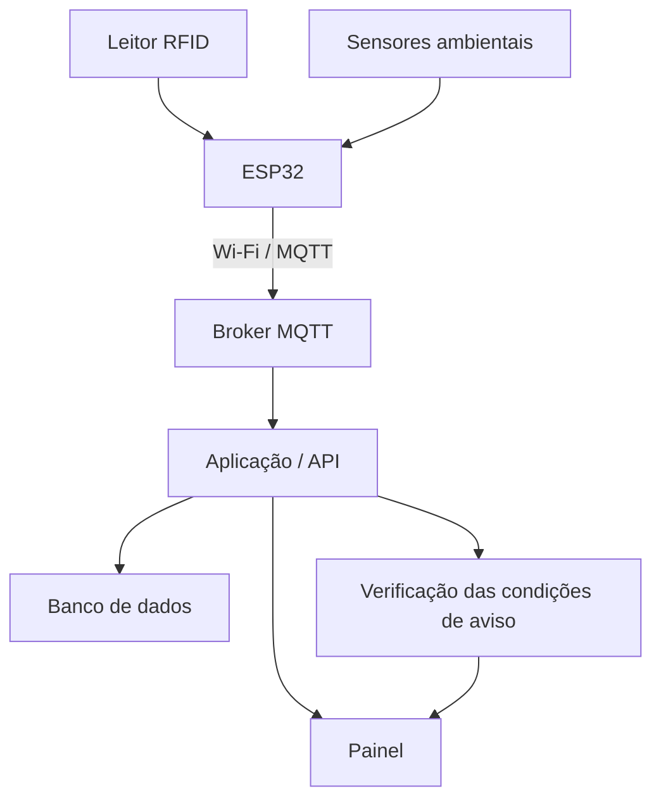

# Trunfo Atômico — Disruptive Architectures: IoT, IoB & Generative IA

**FIAP | Challenge 2026**  
**Disciplina:** Disruptive Architectures: IoT, IoB & Generative IA  
**Projeto do grupo:** Trunfo Atômico  
**Contexto do Challenge:** CTMSP / Marinha do Brasil

## Integrantes

<table>
  <tr>
    <td>Diego Paulino — RM 566841</td>
    <td>Guilherme Dabul — RM 559901</td>
  </tr>
  <tr>
    <td>Renan Lima — RM 568321</td>
    <td>Ryan Mazali — RM 567168</td>
  </tr>
  <tr>
    <td colspan="2" align="center">Thiago Alexandre — RM 567486</td>
  </tr>
</table>

## Apresentação

O Trunfo Atômico é um projeto de aplicativo educativo sobre isótopos radioativos e suas aplicações. O conteúdo é apresentado por meio de cartas, comparações entre atributos e do cálculo de decaimento na função *Quanto sobra?*.

Para a disciplina de IoT e Redes, o grupo propõe uma aplicação de monitoramento em um setor hospitalar que utiliza materiais radioativos. A ideia é registrar a passagem de frascos identificados, acompanhar condições ambientais e reunir essas informações em um painel. O estudo relaciona o conteúdo sobre meia-vida do Trunfo Atômico a uma situação prática.

A proposta também se relaciona ao **Desafio 02 — Segurança física em instalações nucleares**, apresentado pela AMAZUL no kickoff do Challenge. O trabalho apresenta a arquitetura prevista e explica seu funcionamento, sem implantação física.

## 1. Aplicação proposta

O sistema previsto utiliza etiquetas RFID para identificar os frascos e um leitor na porta do setor para registrar passagens. Sensores coletariam informações sobre a radiação ambiental, a temperatura e a umidade da sala. Esses registros seriam enviados a uma aplicação, onde poderiam ser consultados e avaliados de acordo com as condições definidas para o monitoramento.

O objetivo é reunir as informações em um único local e indicar ocorrências que precisem de verificação. A leitura RFID identifica o frasco no ponto de passagem; a autorização e a caracterização de uma saída dependem dos registros de movimentação mantidos no sistema.

## 2. Componentes e localização

| Componente | Função | Local previsto |
| --- | --- | --- |
| Etiqueta RFID | Identificar cada frasco por um código | Em cada frasco |
| Leitor RFID | Registrar a identificação na passagem | Porta do setor |
| Sensor Geiger-Müller | Coletar dados de radiação ambiental | Sala de armazenamento |
| Sensor de temperatura e umidade | Registrar as condições ambientais | Sala de armazenamento |
| ESP32 | Receber as informações dos dispositivos e encaminhá-las à rede | No setor, junto ao leitor RFID da porta |

Como referência para uma futura montagem, podem ser usados módulos comuns em projetos com microcontroladores: leitor RFID RC522, em que o frasco é aproximado do leitor ao passar pela porta; sensor DHT22 de temperatura e umidade; e um módulo contador Geiger-Müller.

## 3. Comunicação e tratamento dos dados

O ESP32 receberia os registros dos módulos conectados por interfaces compatíveis com cada equipamento. A transmissão ocorreria por **Wi-Fi**, com uso do protocolo **MQTT**. Um broker receberia as mensagens e as encaminharia à aplicação responsável pelo processamento.

A aplicação registraria as informações em um banco de dados e verificaria as condições previstas para cada evento. O painel permitiria consultar as leituras, as passagens identificadas e os avisos. O painel seria usado pela equipe de medicina nuclear e pelo responsável pela proteção radiológica do setor, que recebem os avisos e decidem o que fazer em cada caso. Esse funcionamento segue a sequência de entrada, processamento e saída estudada na disciplina.

## 4. Fluxograma

O [fluxograma detalhado](diagramas/fluxo-de-informacoes.md) apresenta o tratamento dos registros de passagem e das leituras ambientais, além do cálculo de decaimento em um fluxo separado.

## 5. Resultados esperados

O painel apresentaria três tipos de aviso:

1. **Movimentação sem autorização:** aviso quando o sistema registrar a saída de um frasco sem autorização válida.
2. **Alteração da radiação ambiental:** aviso diante de elevação das leituras do sensor, acima de um valor de referência definido para a demonstração.
3. **Decaimento de uma fonte:** estimativa da quantidade restante, calculada a partir da meia-vida, com indicação quando atingir a referência definida para o exercício.

Os resultados permitiriam acompanhar registros e compreender a utilidade dos sensores e da comunicação em rede.

## Documentação

| Documento | Conteúdo |
| --- | --- |
| [Contextualização](docs/01-contextualizacao.md) | Problema e relação com o Trunfo Atômico |
| [Componentes e localização](docs/02-equipamentos.md) | Equipamentos, funções e locais previstos |
| [Transmissão de dados](docs/03-transmissao-de-dados.md) | Rede, protocolo e processamento das mensagens |
| [Fluxo de informações](diagramas/fluxo-de-informacoes.md) | Caminho dos dados e decisões previstas |
| [Monitoramento](docs/04-monitoramento.md) | Registros e condições de aviso |

## Limites da proposta

A documentação apresenta uma proposta conceitual. Não houve montagem de circuito, coleta real de dados, instalação hospitalar ou integração funcional com o aplicativo. Os exemplos de avisos não representam parâmetros de segurança radiológica ou critérios de uso clínico. O cálculo de decaimento é uma estimativa teórica e não substitui uma medição de radiação.

## Vídeo

A apresentação da proposta terá aproximadamente cinco minutos e será publicada no YouTube como não listada. O link será incluído após a gravação.
