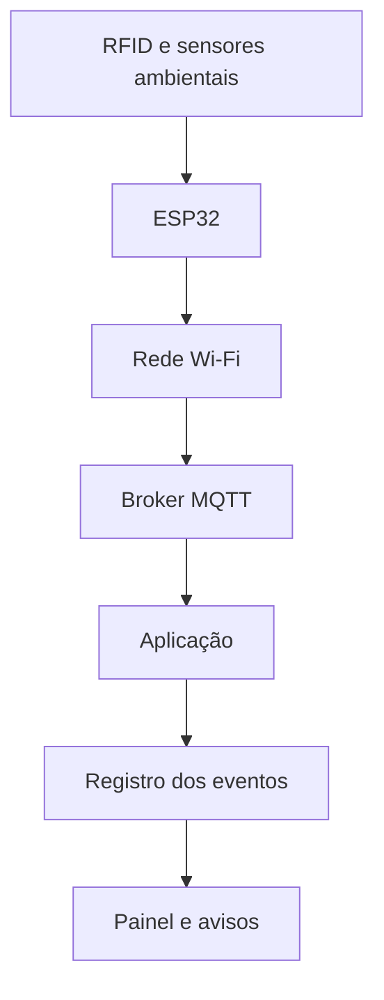

# Trunfo Atômico — IoT e Redes

**FIAP | Challenge 2026 — Sprint 1**  
**Disciplina:** Disruptive Architectures: IoT, IoB & Generative IA  
**Projeto:** Trunfo Atômico | CTMSP — Marinha do Brasil

## Resumo

O Trunfo Atômico é um aplicativo educativo sobre isótopos e suas aplicações. Na disciplina de IoT e Redes, o grupo propõe um sistema de identificação e monitoramento de recipientes com materiais radioativos, tendo como referência um setor hospitalar. O trabalho corresponde a uma proposta de arquitetura, sem instalação física nesta Sprint.

A aplicação se relaciona ao **Desafio 02 — Segurança física em instalações nucleares**, apresentado pela AMAZUL no kickoff do Challenge. A finalidade é demonstrar como identificação eletrônica, sensores e comunicação em rede podem apoiar o registro de eventos e a visualização de situações que exigem verificação.

## Objetivo

Descrever os componentes necessários, a comunicação entre dispositivos, o fluxo dos dados e as informações que o sistema disponibilizaria. O cenário também permite relacionar os registros do monitoramento ao estudo de meia-vida já presente no aplicativo.

## Descrição da solução

| Elemento | Aplicação |
| --- | --- |
| RFID | Identificação de recipientes em pontos de passagem |
| Sensor de radiação ambiental | Leitura das condições radiológicas do ambiente, em caráter conceitual |
| Sensor de temperatura e umidade | Registro das condições ambientais |
| ESP32 | Recepção e organização das leituras |
| Wi-Fi e MQTT | Transmissão das mensagens |
| Aplicação e banco de dados | Registro e consulta de eventos |
| Painel | Apresentação de informações e avisos |

A movimentação de um recipiente é identificada pela leitura RFID e avaliada conforme a existência de autorização cadastrada. Caso não haja autorização válida para a saída, o painel apresenta um aviso. O RFID não determina, isoladamente, a localização contínua nem a autorização do transporte.

## Arquitetura de comunicação

O processamento previsto segue a sequência de **entrada, processamento e saída**, presente nos conteúdos estudados na disciplina. O [fluxograma de funcionamento](diagramas/fluxo-de-informacoes.md) apresenta as verificações após o recebimento dos registros.

## Documentação técnica

| Documento | Conteúdo |
| --- | --- |
| [01 — Contextualização](docs/01-contextualizacao.md) | Problema, objetivos e relação com o Challenge |
| [02 — Equipamentos](docs/02-equipamentos.md) | Componentes, funções e locais previstos |
| [03 — Transmissão de dados](docs/03-transmissao-de-dados.md) | Comunicação Wi-Fi, MQTT e tratamento das mensagens |
| [04 — Monitoramento](docs/04-monitoramento.md) | Registro de eventos e condições de aviso |
| [05 — Relação com a disciplina](docs/05-relacao-com-a-disciplina.md) | Fundamentos das aulas aplicados à arquitetura |
| [06 — Referências](docs/06-referencias.md) | Materiais consultados |
| [Fluxo de informações](diagramas/fluxo-de-informacoes.md) | Fluxograma do processamento |

## Relação com o Trunfo Atômico

As funcionalidades do aplicativo são o Álbum de Cartas, o Duelo e o cálculo **Quanto sobra?**, além de perguntas de "Mito ou verdade?" no detalhe das cartas. O estudo de IoT complementa esse conteúdo ao apresentar um cenário de identificação, leitura e registro de informações. O cálculo de meia-vida permanece uma estimativa teórica e não substitui medições radiológicas.

## Escopo e limitações

A Sprint 1 compreende a documentação da proposta de IoT e Redes. Não foram realizados testes com materiais radioativos, medições ambientais ou implantação hospitalar. Os alertas descritos são exemplos de funcionamento, não critérios operacionais de radioproteção.

## Integrantes

Guilherme, Diego, Ryan, Renan e Thiago.  
**Curso:** Análise e Desenvolvimento de Sistemas — FIAP.

## Vídeo da apresentação

O vídeo explicativo de aproximadamente cinco minutos será publicado no YouTube como não listado. **Link pendente de inclusão após a gravação.**
