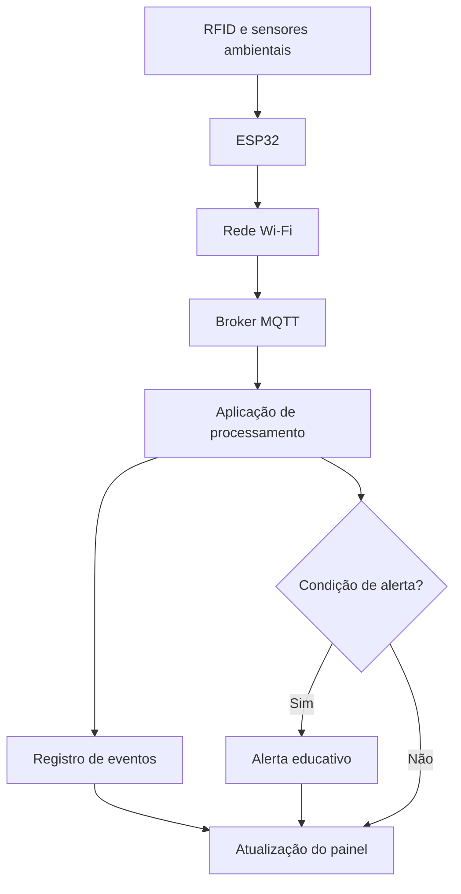

# Trunfo Atômico | IoT e Redes

**Challenge FIAP 2026 — Sprint 1**  
**Disruptive Architectures: IoT, IoB & Generative IA**  
**Projeto acadêmico em parceria com o CTMSP / Marinha do Brasil**

## Apresentação

O Trunfo Atômico é uma proposta de aplicativo educativo sobre os usos da tecnologia nuclear. Por meio de cartas de isótopos, duelos de atributos e simulações de meia-vida, o projeto busca tornar esse conhecimento mais acessível.

Nesta disciplina, apresentamos uma **extensão conceitual de Internet das Coisas (IoT)**: um cenário de monitoramento de materiais radioativos em um ambiente hospitalar, representado de forma educativa no aplicativo.

A proposta está relacionada ao **Desafio 02 — Segurança física em instalações nucleares**, apresentado pela AMAZUL no kickoff do Challenge em 13 de outubro de 2026. O sistema proposto utiliza sensores e identificação eletrônica para registrar eventos e ilustrar alertas em situações fora das condições previstas.

> **Escopo:** a Sprint 1 exige a descrição da aplicação, dos componentes, da comunicação e do fluxo de dados. Não há implementação física ou integração funcional com o aplicativo nesta etapa. Os exemplos apresentados são simulações educativas.

## Objetivo

Demonstrar como dispositivos conectados podem contribuir para a identificação de recipientes, a coleta de dados ambientais e a apresentação de alertas, relacionando esses conceitos ao conteúdo de meia-vida trabalhado no Trunfo Atômico.

## Funcionamento proposto

1. Uma etiqueta RFID identifica o recipiente em um ponto de passagem.
2. Um leitor RFID registra a identificação; sensores acompanham as condições ambientais.
3. Um ESP32 reúne os dados e os envia por Wi-Fi, usando MQTT, a um servidor de mensagens.
4. Uma aplicação recebe os registros, consulta as condições definidas para o cenário e organiza as informações.
5. O painel educativo apresenta registros, estimativas de decaimento e alertas simulados.

**Exemplo de alerta:** o recipiente é identificado na saída do setor e não existe autorização registrada para essa movimentação. O painel informa a ocorrência. A etiqueta RFID, isoladamente, não determina autorização ou localização contínua.

## Componentes e tecnologias

| Recurso | Finalidade na proposta |
| --- | --- |
| Etiqueta e leitor RFID | Identificar recipientes em pontos de passagem |
| Detector de radiação Geiger-Müller | Ilustrar a coleta de leituras ambientais |
| Sensor de temperatura e umidade | Acompanhar condições do ambiente |
| ESP32 | Receber leituras e enviar mensagens |
| Wi-Fi | Conectar o dispositivo à rede local |
| MQTT e broker | Transportar as mensagens dos dispositivos |
| Aplicação e armazenamento | Registrar, processar e consultar os eventos |
| Painel educativo | Exibir informações e alertas simulados |

## Arquitetura e fluxo

O diagrama representa uma **arquitetura prevista**, não um sistema já implantado.

## Integração com o jogo

O Álbum apresenta os isótopos e suas aplicações; o Duelo compara atributos; a função **Quanto sobra?** apresenta o cálculo teórico de decaimento. A extensão IoT utiliza um cenário de monitoramento para mostrar por que registros e medições são importantes no contexto nuclear.

A estimativa calculada pela meia-vida não substitui uma medição radiológica, nem determina, por si só, condições de uso clínico.

## Relação com as aulas da disciplina

A organização da proposta segue o modelo **entrada → processamento → saída**, utilizado nas aulas de introdução à programação e microcontroladores:

- **Entrada e identificação:** RFID identifica o recipiente no ponto de leitura; sensores produzem registros de condições ambientais.
- **Processamento:** o microcontrolador recebe os dados e a aplicação interpreta os eventos por condições previamente definidas.
- **Comunicação:** a rede Wi-Fi transporta as mensagens, com MQTT previsto como protocolo de comunicação na arquitetura.
- **Saída:** o painel apresenta os registros e os avisos educativos.

As aulas também abordam pinos digitais e analógicos, monitor serial, estruturas condicionais e ferramentas de simulação. Esses fundamentos ajudam a explicar uma futura implementação, mas **não constituem funcionalidades implementadas nesta Sprint**. A documentação acadêmica detalha essa relação em [Fundamentos aplicados das aulas](docs/fundamentos-das-aulas.md).

## Documentação

- [Descrição técnica da proposta](docs/proposta-tecnica.md)
- [Componentes e locais previstos](docs/componentes.md)
- [Comunicação e tratamento de dados](docs/comunicacao.md)
- [Condições e alertas](docs/alertas.md)
- [Fluxograma detalhado](diagramas/fluxograma.md)
- [Roteiro de apresentação](apresentacao/roteiro-video.md)
- [Referências e fontes](docs/referencias.md)

## Entrega da disciplina

A entrega oficial prevê um arquivo ZIP contendo o link do **vídeo no YouTube, como não listado, com aproximadamente cinco minutos**, e o link deste repositório com a documentação e o fluxograma.

**Vídeo:** a inserir após a gravação.

## Equipe

Diego · Ryan · Renan · Guilherme · Thiago

**FIAP · Análise e Desenvolvimento de Sistemas · 2026**

---

*Material acadêmico e conceitual. Não representa um sistema de segurança operacional, monitoramento radiológico homologado ou procedimento para manuseio de material radioativo.*
