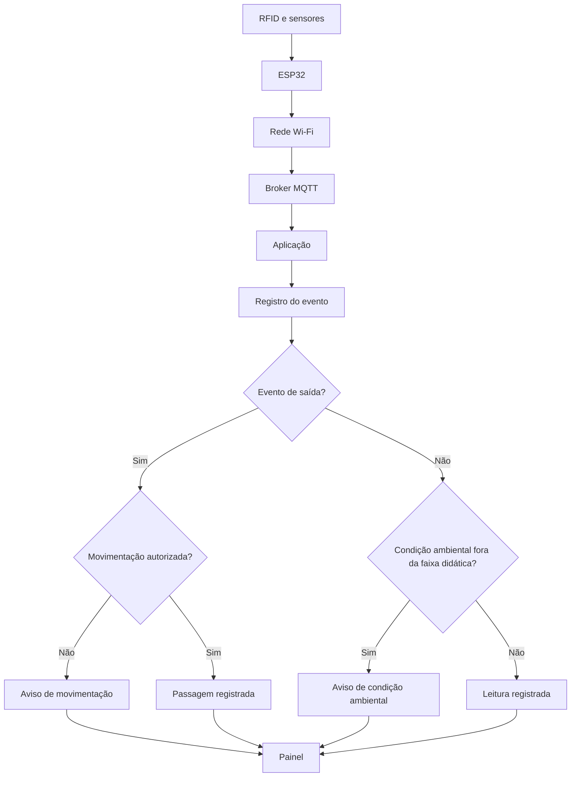

# Fluxo de informações

O esquema apresenta a sequência prevista de coleta, transmissão, registro e exibição. A verificação de autorização ocorre após o recebimento da identificação RFID.

As condições são definidas exclusivamente para explicar a lógica de funcionamento. O esquema não descreve um sistema operacional instalado em hospital.
