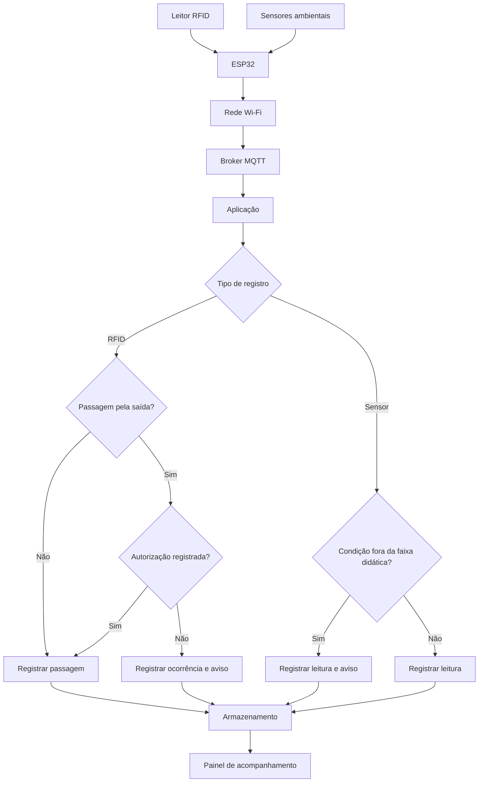

# Fluxo de informações

O fluxo abaixo apresenta o caminho percorrido pelos registros, desde a coleta até a consulta no painel. Após o recebimento da mensagem, a aplicação trata separadamente a identificação por RFID e as leituras dos sensores ambientais.

## Interpretação dos registros

A leitura RFID informa a identificação de um recipiente em um ponto específico. A verificação da autorização de movimentação depende de informação cadastrada na aplicação. Os sensores ambientais são tratados em um fluxo próprio, sem associação automática a uma passagem de recipiente.

As condições de aviso têm finalidade didática. O diagrama representa a arquitetura proposta pelo grupo, não uma instalação hospitalar em funcionamento.
