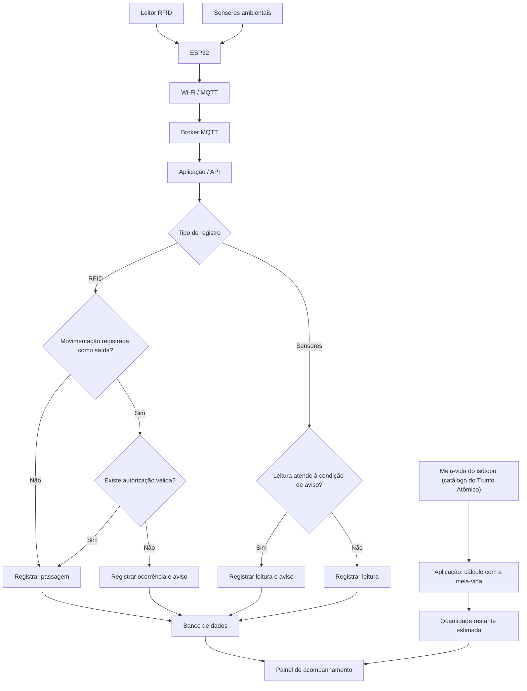

# Fluxo de informações

O fluxograma apresenta o caminho dos dados desde a coleta até o painel de acompanhamento. O leitor RFID registra a identificação dos frascos no ponto de passagem, enquanto os sensores coletam informações sobre o ambiente. O ESP32 recebe esses registros e os envia por Wi-Fi e MQTT ao broker, que os encaminha à aplicação.

A aplicação trata cada tipo de informação separadamente: consulta os registros de autorização quando há uma movimentação identificada como saída e verifica as condições estabelecidas para as leituras ambientais. A estimativa de decaimento segue outro caminho, usando informações da fonte e o conceito de meia-vida.

O caminho de decaimento utiliza a quantidade inicial, a meia-vida do isótopo e o tempo decorrido, independentemente das leituras dos sensores.
