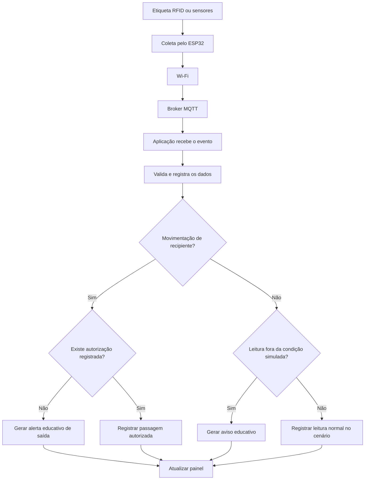

# Fluxograma do monitoramento

O diagrama abaixo detalha o caminho de um evento desde a identificação até a atualização do painel.

## Leitura do fluxograma
A coleta é realizada pelos dispositivos; a comunicação utiliza Wi-Fi e MQTT; e a interpretação dos eventos ocorre na aplicação. A simulação de autorização é uma regra do sistema, não uma capacidade do leitor RFID. O painel apresenta o resultado ao usuário.
